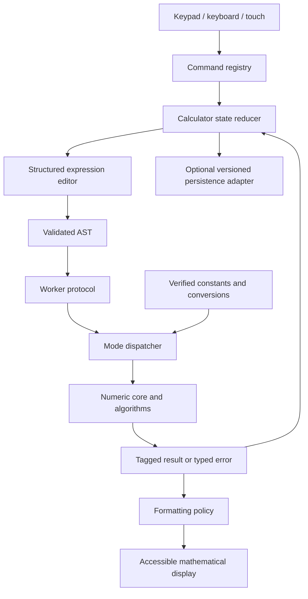

# Architecture

## Boundaries

A local-first browser application separates physical-style interaction, mathematical editing, numerical evaluation and display formatting. No application server is needed for the current scope. The engine cannot depend on DOM, browser storage or UI framework types.

## Agreed technology boundaries

React components and CSS provide the interface, with TypeScript used across the application and Vite for development/build tooling. Pure state reducers and the engine remain independently testable with Vitest. Playwright drives real browser journeys. Web Workers own bounded numerical evaluation. A later PWA layer caches the built application; it does not store executable expression code or evaluate mathematics.

The editor owns an application-specific structured-document contract. MathLive may implement an adapter only after cursor, key, accessibility and template compatibility tests. Its markup is input to validation, not executable mathematics. math.js/decimal.js may supply narrowly scoped numerical operations behind adapters after compatibility evaluation. No generic dependency parser replaces the application security boundary.

## Planned modules

| Module | Responsibility | Must not do |
|---|---|---|
| ui | Casing/layout, buttons, focus, menus, accessible labels | Implement numerical algorithms |
| commands | Key definitions, base/SHIFT/ALPHA layers, mode availability | Mutate hidden global state |
| state | Pure transitions, current expression, cursor, modifier, mode, setup, memory and datasets | Evaluate code or perform network I/O |
| editor | Template insertion/deletion/navigation and linear serialization | Decide numerical approximations |
| syntax | Grammar, AST, validation and source locations | Execute input as code |
| numeric | Value types, conversions, precision, domains and arithmetic | Access DOM or storage |
| modes | COMP/complex/statistics/base/equations/matrix/table/vector adapters after verification | Bypass central capability or error rules |
| algorithms | Bounded calculus, solving, regression and linear algebra | Hang indefinitely or silently coerce types |
| format | Exact/decimal, engineering, fraction, DMS and angle-aware presentation | Change stored mathematical values |
| worker | Schema validation, requests, budgets, cancellation and result delivery | Commit stale results |
| catalogs | Edition-specific constants and conversion records with provenance | Embed unverified values as authoritative |
| persistence | Optional schema-validated local state with migration/reset | Store secrets or enable cloud sync implicitly |

## Evaluation transaction

1. UI commands update state through the reducer; mathematical templates form an AST rather than display-string substitutions.
2. Execute snapshots the expression, mode, setup, variables and state revision.
3. The worker validates the payload, enforces budgets, dispatches through mode capabilities and evaluates with explicit numeric types.
4. A result carries request ID, state revision, typed value/error and diagnostics safe for local display.
5. The reducer accepts only the current transaction. Successful results update Ans and replay history according to verified rules. Errors and cancelled work do not corrupt memory.
6. Formatting derives presentation from the result and setup; S⇔D changes representation when supported.

## Cancellation and recovery

Worker messages alone cannot interrupt a synchronous CPU loop. Algorithms must yield/check a cancellation budget, or the main thread must terminate and replace the worker. Invalidate the request ID first. Define restart/reinitialization behavior and test reset, mode changes, repeated execute and rapid editing during long calculations.

## Data model outline

ExpressionDocument: node tree, selection and cursor path. CalculatorState: mode, setup, modifier, document, replay history, Ans, variables, independent memory and per-mode datasets. NumericValue: discriminated union with precision/exactness metadata. EvaluationRequest: protocol version, ID, revision, AST, context and limits. EvaluationResponse: matching metadata plus value or typed error. CatalogEntry: stable ID, reference index, units, value/transform and evidence.

## Decisions still required

MathLive/editor adapter suitability; numerical library/precision strategy; AST schema; exact-form scope; worker cancellation model; browser support; persistence and PWA implementation details. React, TypeScript, Vite, CSS, Web Workers, Vitest and Playwright are agreed choices. Record each decision with alternatives, evidence, tradeoffs and consequences in DECISIONS.md. Do not treat this proposed architecture as proof of tested implementation.

## Advanced mode composition

Matrix/vector modes combine a dimension-aware data editor, per-mode named storage and typed operations. Equation mode combines coefficient forms and solution navigation; SOLVE belongs to the numerical algorithm service with its own context. Statistics owns dataset/frequency editing and regression selection. BASE-N owns radix and signed-integer policy. TABLE owns function/range input and bounded row generation. Complex mode owns complex display/domain settings. All share command routing, precision policies, typed errors and transactional worker results. No specialist mode may become an isolated calculator with inconsistent Ans, reset or modifier semantics.
