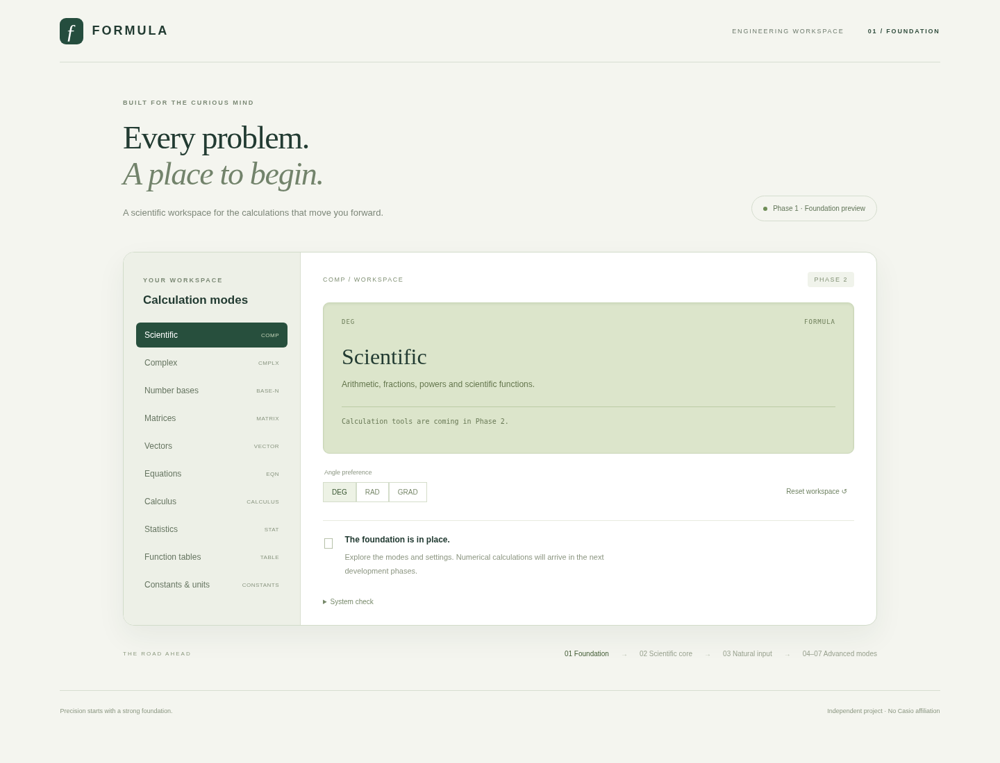

# Phase 1 — Application foundation

Status: complete; awaiting explicit Phase 2 approval. User approved Phase 1 after reviewing the revised Phase 0 package.

## Delivered

React 19.3.1, TypeScript 7.0.2, Vite 8.3.5, Vitest 5.0.5 and Playwright 1.64.1 pinned in the root manifest/lockfile; Node 24.19.0 pinned in .nvmrc. Responsive desktop/mobile application shell with ten navigable planned workspaces, angle preference and reset. These workspaces are application navigation, not a verified transcription of the device MODE menu. Calculations are explicitly marked pending.

Typed numeric/AST contracts, pure state reducer and isolated module worker. Strict versioned health protocol rejects malformed requests/responses. Connection manager rejects stale IDs/revisions, handles crashes, cancels or supersedes requests, enforces a five-second timeout and replaces failed workers. The health operation proves connectivity only; no numerical evaluator exists yet.

GitHub Actions workflow added for clean install, typecheck/build, unit and browser checks. No CI run or public deployment is claimed; local validation is recorded below.

## Actual checks

- Clean `npm ci --ignore-scripts` and production `npm run build`: passed, including TypeScript checks.
- `npm test`: 16 tests passed, zero failures. Includes malformed protocol, stale results, crash recovery, timeout, cancellation, superseding and reducer transitions.
- `CHROMIUM_PATH=/usr/bin/chromium npm run test:e2e`: four tests passed across desktop/mobile viewport projects using installed Chromium. Real worker health, navigation through all ten workspaces, setting/reset, absence of browser page errors and horizontal overflow verified.
- `npm audit --omit=dev`: zero known production dependency vulnerabilities at execution time. This does not establish that all development dependencies are vulnerability-free.
- Desktop screenshot inspected; desktop/mobile captures saved below. Mobile viewport tests are not physical-device certification. No Firefox/Safari or full accessibility audit performed.

## Review images

[Mobile screenshot](reviews/phase1-mobile.png)

## Limitations and next phase

No arithmetic, natural-input editor, advanced numerical mode, persistence, PWA or exact device compatibility is implemented. Numeric/AST types are contracts only; runtime expression validation belongs to the engine phase. The library research dependencies remain separate from application dependencies. Manual verification remains deferred at user direction. The device-style keypad and natural input belong to Phase 3; this foundation shell is not the final calculator design.

Phase 2 will implement the core grammar, numeric values, standard/scientific operations, formatting and mathematical tests after explicit user approval. Full matrices/vectors and other advanced modes remain mandatory later phases.
